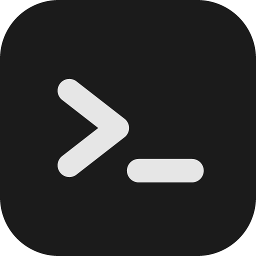
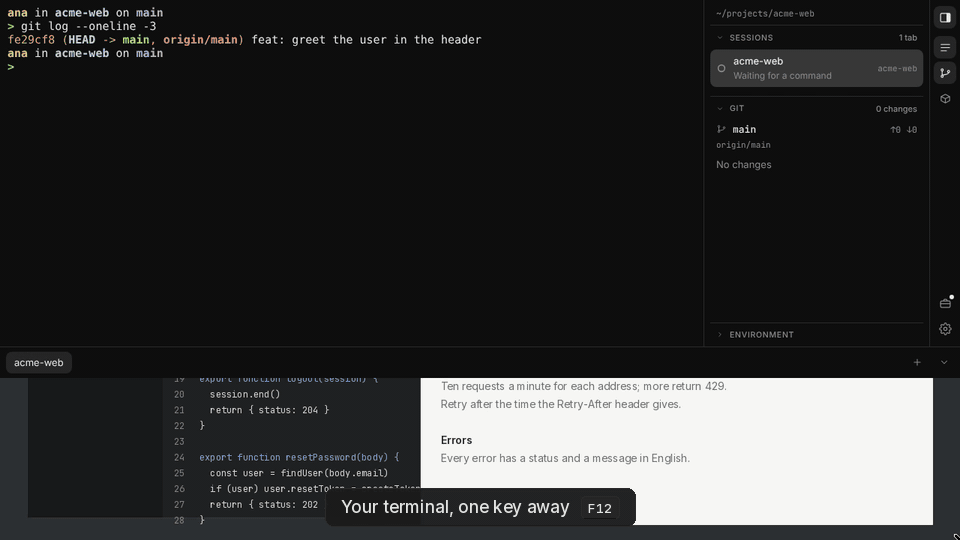
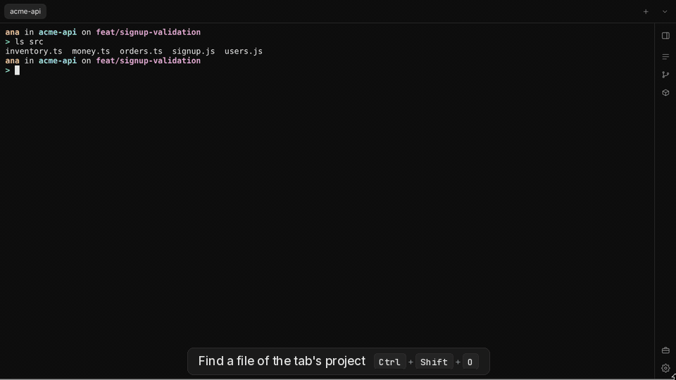
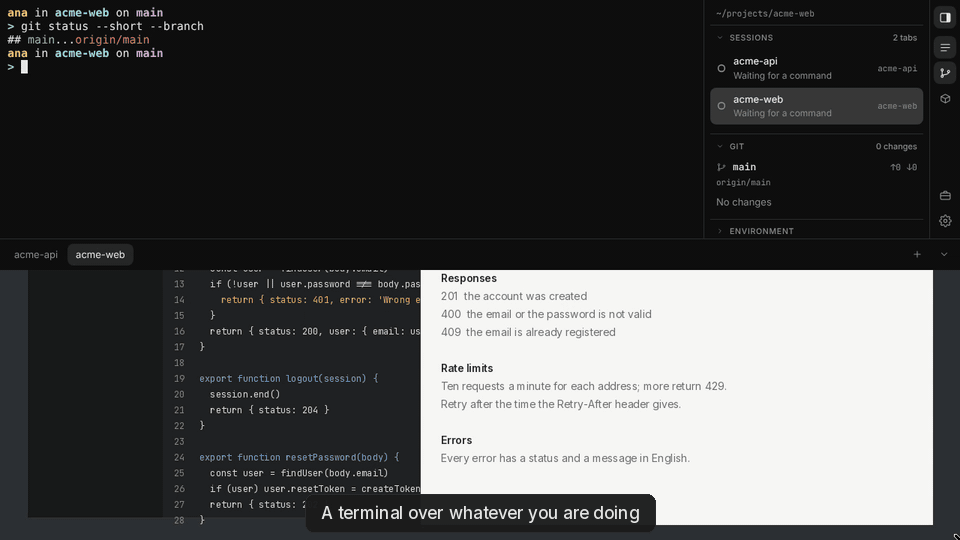
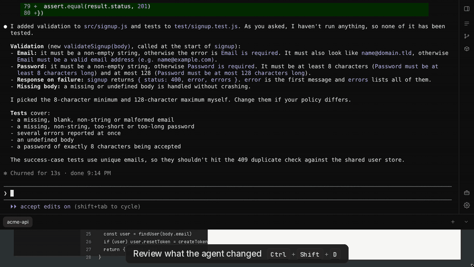
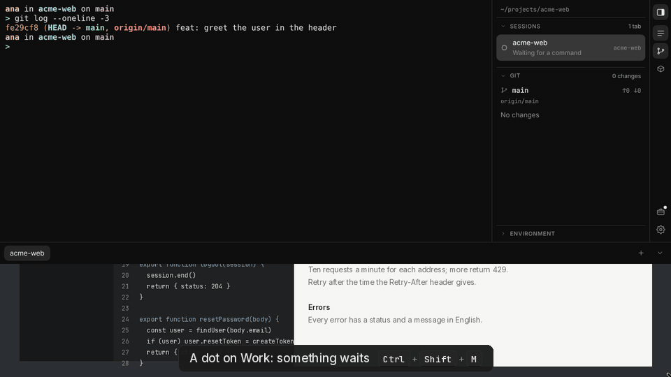

<p align="center">
  
</p>

<h1 align="center">Dev Cockpit</h1>

<p align="center">
  A drop-down terminal for day-to-day development, built for working beside coding agents.<br>
  One key away, keyboard first, light on memory.
</p>

<p align="center">
  <a href="https://github.com/higorabreu/dev-cockpit/actions/workflows/ci.yml"></a>
  <a href="https://github.com/higorabreu/dev-cockpit/releases"></a>
  <a href="LICENSE"></a>
</p>

<p align="center">
  
</p>

`dck` lives behind a global key, like Guake or Quake's console: press `F12` and it drops over whatever
you are doing; press it again and it is gone. Around the terminal it keeps what a working day needs: your
projects, the repository's state, the containers, the coding agent running in each tab, a review of what
changed, and your pull requests, merge requests and tasks. The clips show example data.

## What it does

- **Drop-down window.** `F12` shows or hides it on the monitor where the mouse is; `F11` switches between
  anchored and full height, and dragging its bottom edge sets the anchored height (dragged to the bottom
  of the screen it goes full height; a double click on the edge switches it). Tabs, opacity and font size
  are a key away; a tab can be renamed in place, a middle click closes it, and the tabs open again in
  their folders on the next start.
- **Action wheel.** Hold the right `Ctrl` (configurable, a mouse button too) and the hold menu puts every
  action in one wheel: tabs, projects, the agent and the system. Choose with the arrows or the mouse and
  release to run it. It was inspired by the weapon wheel in Rockstar's games.
- **Projects.** `Ctrl+Shift+P` finds any repository under your projects folder and opens it in a tab
  named after it; pinned and recent projects come first.
- **Side panel.** Each tab's session, the repository's branch, staged and unstaged changes, the commits to
  pull and push and the submodules, and the containers of the project's Compose file. A changed file's
  row opens the review on it.
- **Coding agents.** A tab running an agent is marked when the agent needs you, the panel's Sessions
  button shows a dot, and a notification comes when the tab is out of sight, so you can keep working in
  another tab; a click on the notification brings the cockpit forward on that tab. Claude Code connects
  with its plugin in two commands, Codex (0.163 or newer) needs nothing because it reports its state to
  the terminal, and any agent that runs a command on its own events can send the same signals
  ([docs/agents.md](docs/agents.md)).
- **Review.** What changed in the tab's repository, beside or below its terminal, with comments that go
  back to the agent (below).
- **Connectors.** Your GitHub pull requests, GitLab merge requests and Jira tasks in one screen (below).
- **Files.** `Ctrl+Shift+O` finds a file of the tab's project and opens it over the tab, with the terminal
  alive underneath: text and code in an editor that saves by itself and merges a change on disk, images
  (fit, zoom and pan), SVG as an image or as code, Markdown with its preview beside or instead of the text,
  and PDF in Chromium's viewer. A conflict with the disk is settled change by change in Compare.
- **Terminal.** `Ctrl+click` (`⌘`+click on a Mac) opens links in the browser, a file path over the tab at
  the line a compiler or a test runner printed (`src/app.ts:12:5`, `src/app.ts(12,5)`), with
  `Ctrl+Shift+click` in its default app instead, and a folder in a new tab or the file manager; files
  dropped on it or pasted into it are typed as paths. Selecting copies, and the
  right or middle button pastes (`Ctrl+Shift+C` and `Ctrl+Shift+V` also work). On a Mac the right click
  opens a menu with Copy, Paste and Select all, and `⌘Q` asks first while a tab runs a program.

<p align="center">
  
</p>

<p align="center">
  
</p>

## Review

<p align="center">
  
</p>

`Ctrl+Shift+D` shows what changed in the tab's repository beside or below its terminal, in one scroll:
uncommitted changes, everything since the branch it came from, or the commits not pushed yet. The base
branch is read from what git and VS Code recorded, never guessed from a name, and you can pick another.
Changes inside submodules show in the same review, nested ones too, each submodule reviewed as its own
repository in the same scope, a group with the commits its pointer moved through; its row in the side
panel opens the review on it. Every changed file is listed, and past 300
untracked files the rest load when you open them. It follows the agent as it works, keeping your place,
and marks files as viewed as on GitHub.

Comments left on lines, as in a GitHub review, go back to the agent in one go: written to a Markdown file
in the repository's `.git/dck/`, with one line naming it typed at the tab's prompt, without Enter, for
whatever agent is listening. With no agent in the tab, at a shell prompt or under another program, it
waits and says so, and the comments stay.

## Connectors

<p align="center">
  
</p>

`Ctrl+Shift+M` opens the work screen. **GitHub** (github.com or GitHub Enterprise Server) lists the pull
requests waiting for your review, including the reviews requested from your teams, and your own, with
conflicts, checks and drafts at a glance. **GitLab** does the same for merge requests, with conflicts,
pipelines, open discussions and drafts. **Jira Cloud** lists the tasks assigned to you, grouped by
progress and filtered by project. A dot on the Work button says something waits: a review asked of you,
or one of your own whose checks failed or whose discussion moved since you last looked. Connect them in
Settings, Connections; tokens stay in the system keyring.

All three ship as built-in connector extensions that can be turned off (`dck ext disable dck.github`).
Connectors from third-party extensions are planned; [docs/extensions.md](docs/extensions.md) describes
what exists today.

## Install

Releases carry a `.deb` for Ubuntu 22.04, Debian 12 or newer (x86-64 or arm64, X11 or Wayland) and, since
0.10.0, a `.dmg` for Apple Silicon Macs, signed ad hoc. The `.deb` needs `libsecret-tools` for the system
keyring (the package declares it).

From the 0.11.0 release on, with Node 18 or newer, one command does it: `npx @devcockpit/install`. It
downloads the latest release's file for your system, checks it against the release's `SHA256SUMS` and
installs it (`sudo apt install` on Debian and Ubuntu, which asks for your password; on an Apple Silicon
Mac, the app in `/Applications` and the `dck` command on your PATH). `--version 0.10.0` picks a release
and `--download-only` only downloads and checks it.

By hand on Debian or Ubuntu:

1. Download the `.deb` for your processor (`amd64` for most Intel and AMD PCs, `arm64` for ARM machines;
   `uname -m` prints `x86_64` or `aarch64`) from the [Releases](https://github.com/higorabreu/dev-cockpit/releases)
   page, and the `SHA256SUMS` file next to it.
2. Check it: `sha256sum --check --ignore-missing SHA256SUMS`.
3. Install it: `sudo apt install ./dev-cockpit_<version>_<arch>.deb`.

This installs the app in `/opt/dev-cockpit`, adds a **Dev Cockpit** entry to the application menu and the
`dck` command. The default global key is **F12**. To update, turn on [Updates](#updates) or install the
newer `.deb` over the old one. To start at login, tick **Start with the system** in Settings, System or in
the tray icon menu (off by default). To remove it: `sudo apt remove dev-cockpit`. Data lives in
`~/.config/dev-cockpit`.

By hand on a Mac: open the `.dmg` and drag **Dev Cockpit** to Applications. The app is signed ad hoc, not
notarized, so a copy downloaded by a browser opens the first time with a right click and Open, or after
`xattr -dr com.apple.quarantine "/Applications/Dev Cockpit.app"`. The `dck` command is inside the app;
link it into a folder on your PATH, for example
`ln -s "/Applications/Dev Cockpit.app/Contents/Resources/bin/dck" /usr/local/bin/dck`. Data lives in
`~/Library/Application Support/Dev Cockpit`.

## Updates

Off by default: the cockpit makes no network call of its own. **Updates** in Settings, About chooses:

- **Notify**: checks the project's GitHub releases at start and every 12 hours, without an account and
  sending nothing about you (only the version, in the User-Agent), and says "Version x.y.z available"
  at the end of the tab bar with **Update** and **What's new** (the release page). On a narrow window the
  notice folds into one icon with the same actions in a menu. Dismissing it hides it until a newer
  version; the hold menu's System list keeps the update.
- **Install**: also downloads the `.deb` for your processor, checks it against the release's `SHA256SUMS`
  and installs it with `pkexec` (the system asks for authorization). Then **Restart** opens the tabs again in
  their folders; what runs in them (an agent, a server) ends, so the cockpit asks first while an agent
  runs. Not restarted, the new version starts the next time.

**Check now** beside the setting checks at once. Only stable releases count. A Mac only gets the link to
the release page. The About page also shows the version and links to the repository, the release notes
and a new issue.

## Build from source

Requirements: Node 24 (`nvm use`), pnpm 9 and the system `dpkg-deb`.

```bash
pnpm install
pnpm install:local         # builds the .deb package and installs it (asks for your sudo password)
```

If the cockpit is open, the script **asks before restarting**, because restarting closes the tabs and the
commands running in them. `pnpm install:local --no-restart` installs and lets the new version apply on the
next launch, `--yes` restarts without asking and `--skip-build` installs the `.deb` already built. On a
Mac, `pnpm package:mac` builds the `.app` and the `.dmg` in `release/`.

## Keys

| Key | What it does |
| --- | --- |
| `F12` (configurable) | Shows or hides the window, on the monitor where the mouse is |
| `F11` | Full height or anchored |
| `Ctrl+Shift+T` / `W` | New tab / close tab (a middle click on a tab also closes it) |
| `Ctrl+Shift+R` | Rename the tab in place (also a double-click on it); an empty name brings back the automatic one. The tabs, with their folders and names, open again on the next start |
| `Ctrl+Tab`, `Ctrl+Shift+Tab` | Next / previous tab (also `Ctrl+PgDn`, `Ctrl+PgUp`) |
| `Alt+1` to `8`, `Alt+9` | Go to tab; `Alt+9` goes to the last one |
| `Ctrl+Shift+K` | Clear the terminal and its scrollback (`Ctrl+K` stays with the shell) |
| `Ctrl+Shift+C` / `V` | Copy / paste in the terminal |
| Hold the right `Ctrl` (configurable) | Action wheel: tabs, projects, agent, system. Releasing runs the item |
| `Ctrl+Shift+P` | Project search (`Ctrl+D` pins or unpins a favorite) |
| `Ctrl+Shift+O` | File search in the tab's project, `⌘P` on a Mac; the files git ignores show when what you type finds them, and the same key again includes them all. Settings, Shortcuts offers `Ctrl+P` in one click |
| `Ctrl+Shift+Space` | Between the tab's terminal and its open file |
| `Ctrl+Shift+J` | A Markdown file between its text and its preview, an SVG between its image and its code |
| `Ctrl+F`, `Ctrl+H`, `Ctrl+G` | Inside a file: find, replace and go to line, in a drawer under the file's header; each key swaps one for the other (`Enter` or `F3` next match, `Esc` closes). `Ctrl+D` selects the next occurrence and `Ctrl+S` saves at once |
| `Ctrl +`, `-`, `0` over an image | Zoom in, out and fit (`1` actual size, arrows or a drag pan) |
| `Ctrl+Shift+M` | Work screen: pull requests, merge requests and tasks |
| `Ctrl+Shift+B` | Side panel |
| `Ctrl+Shift+D` | Review what changed in the tab's repository beside or below its terminal; from the terminal it goes back to an open review, from the review it closes it (`Esc` back to the terminal; inside it `↑↓`, `Enter`, `←` `→` fold a submodule in the file list, `[` `]` file, `n` `p` hunk, `v` viewed, `o` open the file at the line in view, `Shift+↑↓` or `Shift`+click select lines, `c` comment, `Ctrl+Enter` save it, `Ctrl+R` refresh) |
| `Ctrl+Shift+E` | Switch the review between side by side and stacked (Settings brings back Automatic) |
| `Ctrl+Shift+Enter` | Write the review's pending comments to a file and type a line naming it at the tab's prompt, without Enter ("Send to agent" in the review header); only while an agent runs in the tab |
| `Ctrl+Shift+Up` / `Down` | Opacity |
| `Ctrl +`, `-`, `0` | Font size |
| `Ctrl+Shift+L` | Switch between light and dark theme |
| `Ctrl+,` | Settings (also through the gear in the panel) |

On a Mac the cockpit's keys use `⌘` where the Mac does and leave Ctrl to the shell: `⌘T`, `⌘W`, `⌘1` to
`⌘8` and `⌘9` for the last tab, `⇧⌘]` and `⇧⌘[` (or `Ctrl+Tab`) for the next and previous tab, `⌘K`
clears, `⌘,` opens Settings, `⌃⌘F` switches the full height (`F11` shows the desktop there) and the
cockpit's own keys are `⇧⌘` and the same letter (`⇧⌘D` the review). Hold the right `⌘` for the action
wheel. At the prompt `⌘←` and `⌘→` go to the ends of the line, `⌘⌫` deletes to its start, `⌥←` and `⌥→`
move by word and `⌥⌦` deletes the next word; a full-screen program gets the raw key. In a file `⌘F`
finds, `⌥⌘F` replaces, `⌘G` goes to the next match and `⌃G` to a line, as in VS Code. The left Option is
Meta (`⌥B`, `⌥F`) and the right one types accents and symbols (Settings, Option as Meta), and `⌥`+drag
selects inside programs that use the mouse. `F12` needs `fn` unless the F keys are set as standard
function keys.

These are the defaults: Settings, Shortcuts changes any of them. Click a key, or press Enter on it, and
press the new one; Esc cancels. A letter or digit needs Ctrl, Alt or `⌘`, an F key can stand alone. A key
another action already has asks first (Swap or Cancel), and a Ctrl key the shell uses (`Ctrl+R`) is
allowed with a note that the terminal no longer gets it. `settings.json` keeps only what you changed:

```jsonc
"shortcuts": {
  "keys": { "newTab": "Ctrl+Alt+N", "fullHeight": "F10" }, // Cmd and Option on a Mac
  "holdTrigger": "Mouse1" // the middle button; Mouse3 back, Mouse4 forward, or a key such as "F13"
}
```

The action wheel opens with any key that types nothing (a modifier, an F key, Caps Lock, Pause) or with
the middle, back or forward mouse button: hold it, move the mouse to an item, release to run it, Esc
cancels. A quick click of the mouse button opens the wheel and leaves it open, for mice that send press and
release together: click an item or press Enter to run it, and Esc, a click elsewhere or the button again
closes it. While a mouse button opens the wheel, its click does nothing else (no middle-click paste, and a
middle click on a tab opens the wheel instead of closing the tab).

The `dck` command controls the window from outside (`dck toggle`, `dck ping`): useful to bind to a system
shortcut if the global key is refused.

## Settings

`Ctrl+,` opens the screen: language, theme (dark, light or the system's), opacity, the interface and code
fonts, the terminal's font, size and cursor (block, bar or underline, blinking or not), which Option is
Meta on a Mac, window height, whether the panel opens at full height, reopening the tabs on start, the
review layout, global key, hold menu key or button, every interface key, projects folder and how deep to
search it, whether files save and merge a change on disk by themselves and where a path clicked in the
terminal opens, start with the system, the threshold to notify a long command, the hint to connect an agent,
and the GitHub, GitLab and Jira connections; an About page shows the version, the updates and the
project's links. Everything applies at once. Settings live in a `settings.json` that can also be edited by
hand, like VS Code's: the button beside the screen's close (or Open the settings file in the hold menu's
System list) opens it in a tab of its own, at its folder, where only Ctrl+S (⌘S on a Mac) saves it, so a
half-typed edit never applies; it takes comments and trailing commas, and whatever you save applies at
once while the screen's own changes keep your comments and layout. A value it cannot use goes back to its
default or to the nearest limit: the screen marks the file button (its tooltip counts the warnings) and
the pages that have one and says under each setting what the file holds and what is used instead, and its
reset writes the right value back; a file that is not valid JSON keeps the last good settings, the controls
wait, and a line above the page says the line and column to fix. The `DCK_KEY`, `DCK_HEIGHT` and
`DCK_PROJECTS_ROOT` variables win over the file.

The interface draws with Inter and JetBrains Mono, which ship with the cockpit. The terminal draws, by
default, with the font of your own terminal (the GNOME Terminal or Ptyxis profile, else the system's
monospace font), so a prompt made for it looks the same; its Powerline and Nerd Font symbols come from a
font installed for them, such as Symbols Nerd Font or a patched font like MesloLGS NF. The terminal follows
the light or dark theme, including the background color a program asks for and the selection.

## Develop without disturbing the installed one

```bash
pnpm dev                   # builds and opens; own profile, socket and key (F9), no tray icon
pnpm dev:dck toggle        # the repository's CLI, talking to the development cockpit
pnpm lint && pnpm typecheck && pnpm test
```

The development build uses `~/.config/dev-cockpit-dev` and the `dck-dev` socket, so it lives beside the
installed one. Read [CONTRIBUTING.md](CONTRIBUTING.md) before sending a change, [docs/](docs/) for the
architecture, decisions and roadmap, and [AGENTS.md](AGENTS.md) for the coding standards. The clips in
this README are recorded from the built app by [scripts/media](scripts/media/README.md).

## Known limits

- Linux is tested on Ubuntu with GNOME on X11 and Wayland. The Mac build is still being tested on real
  Macs ([plans/macos.md](plans/macos.md)) and cannot update itself; Windows comes after it, as adapters.
- The Linux package runs with `--no-sandbox`, because of Ubuntu's sandbox restriction.
- No agent metrics or approvals banner in the panel: the cockpit marks the tab where an agent needs you
  instead (D37).
- Connectors are built in (GitHub, GitLab and Jira Cloud); third-party connectors are not done. The keys
  inside a panel (the review's single keys, the arrows of a list) cannot be changed.
- The file view is a light editor (CodeMirror): no language servers, completion or multi-file tabs.
  Syntax colors go up to 2 MB, editing up to 5 MB and a read only view up to 50 MB; past that, the file
  shows a card that opens it in the system's app.
- The GNOME tray icon opens the menu and does not toggle the window directly.

## License

Copyright (C) 2026 Higor Abreu Freiberger. Dev Cockpit is free software under the
[GNU Affero General Public License v3.0](LICENSE): you may use, study, change and share it, and a
modified version you distribute must be published under the same license, keeping the authorship. The
name "Dev Cockpit" and the logo are not covered by that license: a fork should use its own name.
