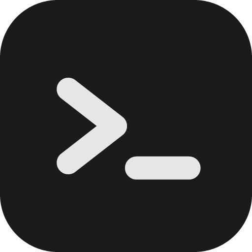

<p align="center">
  
</p>

<h1 align="center">Dev Cockpit</h1>

<p align="center">
  A Guake-style terminal for day-to-day development, keyboard first.
</p>

<p align="center">
  <a href="https://github.com/higorabreu/dev-cockpit/actions/workflows/ci.yml"></a>
</p>

A global key opens and closes it, and it brings tabs, a hold menu, project search, a side panel with
sessions, git and containers, and GitLab merge request views.

Version **0.1.0**. What does not exist yet is listed under [Known limits](#known-limits).

## Install

Requirements: Ubuntu or Debian on x86-64 or arm64 with X11, and `libsecret-tools` for the system keyring
(the package declares it).

1. Download the `.deb` for your processor (`amd64` for most Intel and AMD PCs, `arm64` for ARM machines; `uname -m` prints `x86_64` or `aarch64`) from the
   [Releases](https://github.com/higorabreu/dev-cockpit/releases) page, and the `SHA256SUMS` file next to it.
2. Check it: `sha256sum --check --ignore-missing SHA256SUMS`.
3. Install it: `sudo apt install ./dev-cockpit_<version>_<arch>.deb`.

This installs the app in `/opt/dev-cockpit`, adds a **Dev Cockpit** entry to the application menu and the
`dck` command. The default global key is **F12**. To update, install the newer `.deb` over the old one. To
start at login, tick **Start with the system** in the tray icon menu (off by default). To remove it:
`sudo apt remove dev-cockpit`. Data lives in `~/.config/dev-cockpit`.

## Build from source

Requirements: Node 24 (`nvm use`), pnpm 9 and the system `dpkg-deb`.

```bash
pnpm install
pnpm install:local         # builds the .deb package and installs it (asks for your sudo password)
```

If the cockpit is open, the script **asks before restarting**, because restarting closes the tabs and the
commands running in them. `pnpm install:local --no-restart` installs and lets the new version apply on the
next launch, `--yes` restarts without asking and `--skip-build` installs the `.deb` already built.

## Use

| Key | What it does |
| --- | --- |
| `F12` (configurable) | Shows or hides the window, on the monitor where the mouse is |
| `F11` | Full height or anchored |
| `Ctrl+Shift+T` / `W` | New tab / close tab |
| `Ctrl+Tab`, `Ctrl+Shift+Tab` | Next / previous tab |
| `Alt+1` to `9` | Go to tab |
| Hold the right `Ctrl` | Wheel menu: tabs, projects, agent, system. Releasing runs the item |
| `Ctrl+Shift+P` | Project search (`Ctrl+D` pins or unpins a favorite) |
| `Ctrl+Shift+M` | Merge request views |
| `Ctrl+Shift+B` | Side panel |
| `Ctrl+Shift+Up` / `Down` | Opacity |
| `Ctrl +`, `-`, `0` | Font size |
| `Ctrl+Shift+L` | Switch between light and dark theme |
| `Ctrl+,` | Settings (also through the gear in the panel) |

Selecting text copies it; the right and middle buttons paste. The `dck` command controls the window from
outside (`dck toggle`, `dck ping`): useful to bind to a system shortcut if the global key is refused.

A tab running a coding agent is marked when it needs you; [docs/agents.md](docs/agents.md) wires Claude Code in two commands.

## Settings

`Ctrl+,` opens the screen: language, theme, opacity, font, window height, global key, hold menu key,
projects folder, start with the system, the threshold to notify a long command, and the GitLab
connection. Everything applies at once. Settings live in a `settings.json` that can also be edited by
hand; an invalid field goes back to its default. The `DCK_KEY`, `DCK_HEIGHT` and `DCK_PROJECTS_ROOT`
variables win over the file.

## Develop without disturbing the installed one

```bash
pnpm dev                   # builds and opens; own profile, socket and key (F9), no tray icon
pnpm dev:dck toggle        # the repository's CLI, talking to the development cockpit
pnpm lint && pnpm typecheck && pnpm test
```

The development build uses `~/.config/dev-cockpit-dev` and the `dck-dev` socket, so it lives beside the
installed one. Read [CONTRIBUTING.md](CONTRIBUTING.md) before sending a change, [docs/](docs/) for the
architecture, decisions and roadmap, and [AGENTS.md](AGENTS.md) for the coding standards.

## Known limits

- Linux with X11 only, tested on Ubuntu 24.04 and GNOME. macOS is planned ([plans/macos.md](plans/macos.md))
  and Windows after it, both as adapters.
- The package runs with `--no-sandbox`, because of Ubuntu's sandbox restriction.
- No Claude approvals banner and no agent data in the panel (the code is dormant, see D26).
- GitLab only for now; Jira and key remapping for the remaining shortcuts are not done.
- The GNOME tray icon opens the menu and does not toggle the window directly.

## License

Copyright (C) 2026 Higor Abreu Freiberger. Dev Cockpit is free software under the
[GNU Affero General Public License v3.0](LICENSE): you may use, study, change and share it, and a
modified version you distribute must be published under the same license, keeping the authorship. The
name "Dev Cockpit" and the logo are not covered by that license: a fork should use its own name.
