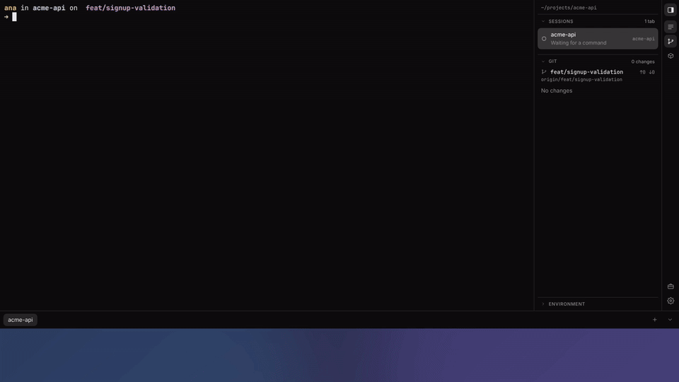

<p align="center">
  
</p>

<h1 align="center">Dev Cockpit</h1>

<p align="center">
  A drop-down terminal for day-to-day development, built for working beside coding agents.<br>
  One key away, keyboard first, light on memory.
</p>

<p align="center">
  <a href="https://github.com/higorabreu/dev-cockpit/actions/workflows/ci.yml"></a>
  <a href="https://github.com/higorabreu/dev-cockpit/releases"></a>
  <a href="LICENSE"></a>
</p>

<p align="center">
  
</p>

`dck` lives behind a global key, like Guake or Quake's console: press `F12` and it drops over whatever
you are doing; press it again and it is gone. Around the terminal it keeps what a working day needs: your
projects, the repository's state, the containers, the coding agent running in each tab, a review of what
changed, and your merge requests and tasks.

## What it does

- **Drop-down window.** `F12` shows or hides it on the monitor where the mouse is; `F11` switches between
  anchored and full height. Tabs, opacity and font size are a key away.
- **Action wheel.** Hold the right `Ctrl` (configurable) and the hold menu puts every action in one wheel:
  tabs, projects, the agent and the system. Choose with the arrows or the mouse and release to run it. It
  was inspired by the weapon wheel in Rockstar's games.
- **Projects.** `Ctrl+Shift+P` finds any repository under your projects folder and opens it in a tab
  named after it; pinned and recent projects come first.
- **Side panel.** Each tab's session, the repository's branch, staged and unstaged changes, the commits to
  pull and push and the submodules, and the containers of the project's Compose file.
- **Coding agents.** A tab running an agent is marked when the agent needs you, with a notification when
  the tab is out of sight, so you can keep working in another tab. Claude Code connects with its plugin
  in two commands, and any agent that runs a command on its own events can send the same signals
  ([docs/agents.md](docs/agents.md)).
- **Review.** `Ctrl+Shift+D` shows what changed in the tab's repository beside or below its terminal, in
  one scroll: uncommitted changes, everything since the branch it came from, or the commits not pushed
  yet. The base branch is read from what git and VS Code recorded, never guessed from a name, and you can
  pick another. It follows the agent as it works, keeping your place, and marks files as viewed as on
  GitHub. Comments left on lines, as in a GitHub review, go back to the agent in one go: written to a
  Markdown file in the repository's `.git/dck/`, with one line naming it typed at the tab's prompt,
  without Enter, for whatever agent is listening.
- **Connectors.** Your GitLab merge requests and Jira tasks in one screen (below).
- **Terminal.** `Ctrl+click` opens links in the browser and file or folder paths in their default app;
  selecting copies and the right or middle button pastes.

## Connectors

<p align="center">
  
</p>

`Ctrl+Shift+M` opens the work screen. **GitLab** lists the merge requests waiting for your review and
your own, with conflicts, pipelines, open discussions and drafts at a glance. **Jira Cloud** lists the
tasks assigned to you, grouped by progress and filtered by project. Connect them in Settings,
Connections; tokens stay in the system keyring.

Both ship as built-in connector extensions that can be turned off (`dck ext disable dck.gitlab`).
Connectors from third-party extensions are planned; [docs/extensions.md](docs/extensions.md) describes
what exists today. The clips show example data.

## Install

Requirements: Ubuntu 22.04 or Debian 12 or newer, on x86-64 or arm64, on X11 or Wayland, and `libsecret-tools` for the system keyring
(the package declares it). macOS builds from source with `pnpm package:mac` and is being tested; it is
not in the releases yet.

1. Download the `.deb` for your processor (`amd64` for most Intel and AMD PCs, `arm64` for ARM machines; `uname -m` prints `x86_64` or `aarch64`) from the
   [Releases](https://github.com/higorabreu/dev-cockpit/releases) page, and the `SHA256SUMS` file next to it.
2. Check it: `sha256sum --check --ignore-missing SHA256SUMS`.
3. Install it: `sudo apt install ./dev-cockpit_<version>_<arch>.deb`.

This installs the app in `/opt/dev-cockpit`, adds a **Dev Cockpit** entry to the application menu and the
`dck` command. The default global key is **F12**. To update, install the newer `.deb` over the old one. To
start at login, tick **Start with the system** in the tray icon menu (off by default). To remove it:
`sudo apt remove dev-cockpit`. Data lives in `~/.config/dev-cockpit`.

## Build from source

Requirements: Node 24 (`nvm use`), pnpm 9 and the system `dpkg-deb`.

```bash
pnpm install
pnpm install:local         # builds the .deb package and installs it (asks for your sudo password)
```

If the cockpit is open, the script **asks before restarting**, because restarting closes the tabs and the
commands running in them. `pnpm install:local --no-restart` installs and lets the new version apply on the
next launch, `--yes` restarts without asking and `--skip-build` installs the `.deb` already built.

## Keys

| Key | What it does |
| --- | --- |
| `F12` (configurable) | Shows or hides the window, on the monitor where the mouse is |
| `F11` | Full height or anchored |
| `Ctrl+Shift+T` / `W` | New tab / close tab |
| `Ctrl+Tab`, `Ctrl+Shift+Tab` | Next / previous tab |
| `Alt+1` to `9` | Go to tab |
| Hold the right `Ctrl` | Action wheel: tabs, projects, agent, system. Releasing runs the item |
| `Ctrl+Shift+P` | Project search (`Ctrl+D` pins or unpins a favorite) |
| `Ctrl+Shift+M` | Work screen: merge requests and tasks |
| `Ctrl+Shift+B` | Side panel |
| `Ctrl+Shift+D` | Review what changed in the tab's repository beside or below its terminal; from the terminal it goes back to an open review, from the review it closes it (`Esc` back to the terminal; inside it `↑↓`, `Enter`, `[` `]` file, `n` `p` hunk, `v` viewed, `Shift+↑↓` or `Shift`+click select lines, `c` comment, `Ctrl+Enter` save it, `Ctrl+R` refresh) |
| `Ctrl+Shift+E` | Switch the review between side by side and stacked (Settings brings back Automatic) |
| `Ctrl+Shift+Enter` | Write the review's pending comments to a file and type a line naming it at the tab's prompt, without Enter ("Send to agent" in the review header) |
| `Ctrl+Shift+Up` / `Down` | Opacity |
| `Ctrl +`, `-`, `0` | Font size |
| `Ctrl+Shift+L` | Switch between light and dark theme |
| `Ctrl+,` | Settings (also through the gear in the panel) |

The `dck` command controls the window from outside (`dck toggle`, `dck ping`): useful to bind to a system
shortcut if the global key is refused.

## Settings

`Ctrl+,` opens the screen: language, theme, opacity, font, window height, global key, hold menu key,
projects folder, start with the system, the threshold to notify a long command, the review layout and
the GitLab and Jira connections. Everything applies at once. Settings live in a `settings.json` that can also be edited by
hand; an invalid field goes back to its default. The `DCK_KEY`, `DCK_HEIGHT` and `DCK_PROJECTS_ROOT`
variables win over the file.

## Develop without disturbing the installed one

```bash
pnpm dev                   # builds and opens; own profile, socket and key (F9), no tray icon
pnpm dev:dck toggle        # the repository's CLI, talking to the development cockpit
pnpm lint && pnpm typecheck && pnpm test
```

The development build uses `~/.config/dev-cockpit-dev` and the `dck-dev` socket, so it lives beside the
installed one. Read [CONTRIBUTING.md](CONTRIBUTING.md) before sending a change, [docs/](docs/) for the
architecture, decisions and roadmap, and [AGENTS.md](AGENTS.md) for the coding standards.

## Known limits

- Linux in the releases, tested on Ubuntu with GNOME on X11 and Wayland. macOS builds from source and is
  being tested ([plans/macos.md](plans/macos.md)); Windows comes after it, as adapters.
- The package runs with `--no-sandbox`, because of Ubuntu's sandbox restriction.
- No agent metrics or approvals banner in the panel: the cockpit marks the tab where an agent needs you
  instead (D37).
- Connectors are built in (GitLab and Jira Cloud); third-party connectors and key remapping for the
  remaining shortcuts are not done.
- The GNOME tray icon opens the menu and does not toggle the window directly.

## License

Copyright (C) 2026 Higor Abreu Freiberger. Dev Cockpit is free software under the
[GNU Affero General Public License v3.0](LICENSE): you may use, study, change and share it, and a
modified version you distribute must be published under the same license, keeping the authorship. The
name "Dev Cockpit" and the logo are not covered by that license: a fork should use its own name.
